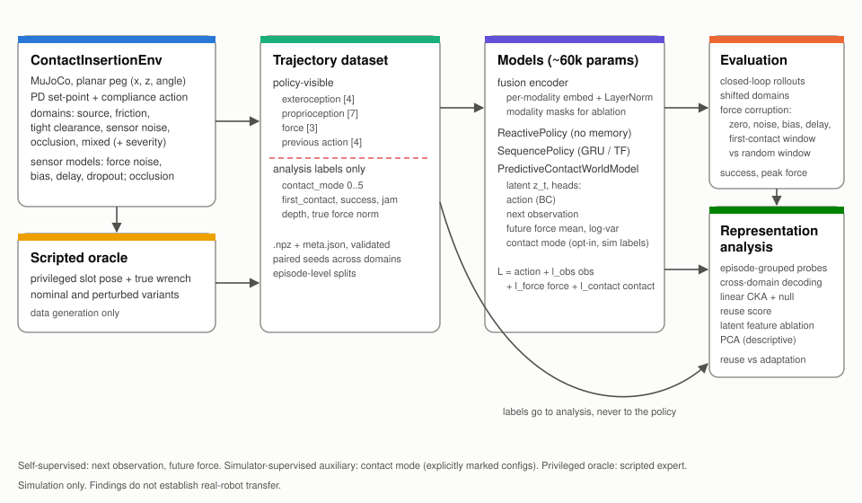

# Contact-State Reuse: Predictive Force-Aware World Models for Flexible Robot Manipulation

**Claim under test:** in a simulated planar insertion task, a model trained to predict future observations and contact forces may learn latent "contact states" that carry over to changed physics, and the degree of carry-over may predict how quickly and safely the model adapts. This repository tests that claim; it does not assume it. All results are from simulation and say nothing yet about real robots.



## Motivation

Insertion, pressing and assembly tasks are decided after the moment of contact, which is where cameras are least informative and where force and proprioception carry the most information. Most learned manipulation policies treat force as one more input to concatenate. This project asks a narrower question: does force help mainly as an input, or because it lets a predictive model build a representation of the interaction state (approaching, touching, aligning, jammed, inserting) that stays useful when the physics changes?

The framing comes from computational neuroscience. In my doctoral work on prefrontal representations, flexible behaviour depended on population activity patterns that were reused when task contingencies changed. Systems neuroscience has tools for this kind of question: decoding with held-out conditions, representational similarity across conditions, event-aligned trajectories, and perturbation of selected features. This repository applies those tools to the latent states of robot-learning models, with the caution that a similar analysis does not imply a similar mechanism.

## Hypotheses and how they could fail

| # | Hypothesis | Supported if | Falsified if |
|---|---|---|---|
| H1 | Force and proprioception improve success and safety, mostly under physical shifts | Experiment A: the paired difference (with minus without force) in success or peak force has a 95 % CI excluding 0 on shifted domains, and is larger there than on source | CIs include 0 on shifted domains, or the effect is as large on source as under shift |
| H2 | Predictive pre-training produces latents that encode contact phase | Experiment B / analysis: episode-grouped probe accuracy on predictive-model latents exceeds the sequence-BC baseline by a margin larger than seed variation | Probe accuracy is equal or lower than the BC baseline |
| H3 | Contact-state representations are reused across the physical shift | Experiment D: reuse score (phase-matched CKA, normalised by a permutation null) is clearly above 0 and cross-domain probes stay above chance | Reuse near 0, or cross-domain probe accuracy near chance |
| H4 | More reuse goes with faster, safer adaptation | Experiment D: Spearman correlation between reuse score and adaptation efficiency (and peak-force reduction) is positive with a CI excluding 0 | CI includes 0 or the sign is negative. Even if supported, this is a correlation across models, seeds and shift levels, not evidence that reuse causes faster adaptation |
| H5 | Force matters specifically around first contact | Experiment C: zeroing force for a window starting at first contact hurts success or safety more than zeroing an equally long window at a random time | No difference between the two windows |

## Environment

`ContactInsertionEnv` (Gymnasium API, MuJoCo physics): a rectangular peg moves in the x-z plane (tip x, tip z, rotation about y) towards a chamfered slot. Each joint is a PD actuator around a set-point; the action moves the set-point and sets a compliance level that scales the PD stiffness. Episodes pass through approach, first contact, alignment, insertion and either success or jam/failure.

| Modality | Dimensions | Content | Policy input |
|---|---|---|---|
| exteroception | 4 | estimated slot entrance relative to the peg tip (x, z), estimated relative angle, estimate-valid flag; a low-dimensional stand-in for a camera pose estimate, with calibration offset, noise and occlusion | yes |
| proprioception | 7 | joint positions, joint velocities, current compliance level (joint efforts optional, off by default) | yes |
| force | 3 | planar contact wrench (Fx, Fz, Ty) summed from MuJoCo contact forces, after a sensor model with noise, bias, delay and dropout | yes |
| analysis labels | 6 classes + scalars | `contact_mode`, `first_contact`, `success`, `jam`, `insertion_depth`, `contact_force_norm` | **never** |

The force signal is an idealised external wrench at the contacts, not a wrist force/torque sensor model and not motor-current sensing. See [docs/limitations.md](docs/limitations.md).

Domains (per-episode randomisation, `src/contact_state_reuse/envs/domains.py`): `source`, `shifted_friction`, `tight_clearance`, `sensor_noise` (force noise, bias, delay, dropout), `occlusion` (exteroception dropped near the slot), and `mixed`. Shifts can be applied at a graded `severity` between source (0) and fully shifted (1).

Contact-mode labels (0 approach, 1 first contact, 2 alignment, 3 insertion, 4 success, 5 jam or failure) are computed from simulator state by fixed rules. They are measurement labels for analysis. They do not claim that real contact phases are discrete.

## Models

All models share a fusion encoder (per-modality linear embedding and LayerNorm, with modality masks for ablations) and are sized to the same parameter budget (about 60k by default).

| Model | Memory | Training signal | Uses simulator labels |
|---|---|---|---|
| `ReactivePolicy` | none (current observation) | behaviour cloning | no |
| `SequencePolicy` | GRU (or causal Transformer) over observation and previous action | behaviour cloning | no |
| `PredictiveContactWorldModel` (default, self-supervised) | same trunk, latent z_t | behaviour cloning + next-observation prediction + future-force prediction (Gaussian mean and log-variance over 5 steps) | no |
| `PredictiveContactWorldModel` with **simulator-supervised auxiliary** | same | above + future contact-mode classification | **yes, as a training target only** (`contact_supervision: true` must be set explicitly) |
| Scripted expert | privileged state | none (it is the data-generation oracle) | reads true slot pose and noise-free wrench |

Three kinds of signal are kept apart throughout:

* **self-supervised**: targets computed from the model's own future observations and force readings;
* **simulator-supervised auxiliary**: contact-mode labels from the simulator used as a training target, only in configurations named `*contactsup*`;
* **privileged oracle**: the scripted expert's access to true geometry and forces, used only to generate demonstrations.

## Quickstart

```bash
# install (Python 3.10+)
python -m venv .venv && source .venv/bin/activate
pip install -e ".[dev]"

# tiny dataset (about 5 s)
python scripts/generate_dataset.py --domain source --episodes 60 --seed 0 --out data

# baseline and predictive model (about 30 s each on a laptop CPU)
python scripts/train.py --data data/source_n60_s0.npz --model configs/models/sequence.yaml --tag sequence
python scripts/train.py --data data/source_n60_s0.npz --model configs/models/world_model.yaml --tag world_model

# evaluate on source and shifted domains, with and without force corruption
python scripts/evaluate.py --checkpoints outputs/train/sequence.pt outputs/train/world_model.pt \
    --domains source tight_clearance --episodes 20 --corruptions none first_contact_window

# everything above plus representation analysis and figures in one command
make demo
```

`make demo` writes figures such as `outputs/demo/<timestamp>/figures/dataset_episodes.png` (force and depth traces with phase labels) and `outputs/demo/<timestamp>/analysis/figures/pca_source.png`.

Experiments:

```bash
make quick        # A-D at quick scale
make full         # A-D at full scale
python scripts/run_experiment.py configs/experiments/D_reuse.yaml --scale quick
```

## Runtime and resources

Measured on a 2-core cloud CPU without GPU. A laptop should be similar or faster.

| Command | Time |
|---|---|
| `make test` | about 20 s (about 10 s without the slow pipeline tests) |
| `make demo` | about 1 minute |
| experiment A or B, quick | about 3 minutes each |
| experiment C, quick | about 1 to 2 minutes |
| experiment D, quick | about 5 minutes |
| full scale, all experiments | several hours on CPU (3 seeds, 400 demonstrations, 3000 updates per model); start separate experiments in parallel processes to use more cores |

A GPU is used automatically when available (`device: auto`). Most evaluation time is MuJoCo simulation on CPU, so a GPU mainly speeds up training.

## Results

No results are reported yet. The table below is filled in by running the commands listed under it; nothing in it should be read as a finding until those runs exist.

| Condition | Source success | Tight clearance success | Peak force, source [N] | Peak force, shifted [N] | Contact-mode probe (balanced acc.) | Reuse score |
|---|---|---|---|---|---|---|
| reactive, extero + proprio | TBD | TBD | TBD | TBD | n/a | n/a |
| reactive, + force | TBD | TBD | TBD | TBD | n/a | n/a |
| sequence BC, + force | TBD | TBD | TBD | TBD | TBD | TBD |
| world model, self-supervised | TBD | TBD | TBD | TBD | TBD | TBD |
| world model, simulator-supervised aux | TBD | TBD | TBD | TBD | TBD | TBD |

How to fill it:

* success and peak force: `results.csv` of experiments A and B (`mean`, `ci_low`, `ci_high` per condition and domain);
* probe and reuse: `reuse_points.csv` of experiment D (`probe_source_bacc`, `reuse`, with `reuse_ci_low`/`reuse_ci_high`);
* H4: `reuse_correlations.json` of experiment D;
* H5: `paired_differences.csv` of experiment C (first-contact window minus random window).

Report seed-level variation (`evaluation.metrics.seed_level`) alongside episode-level intervals, and report null or negative results as they come out.

## Scientific rigour

* **Matched capacity.** Every model is sized to the same parameter budget by searching the hidden width (`models.factory.build_model`); a test checks the counts agree within 10 %. Modality ablations zero inputs through a mask, so the network is identical.
* **Same data and budget.** Within an experiment, every condition uses the same dataset, episode split and number of gradient updates.
* **Episode-level splits.** Train/validation splits and probe cross-validation are grouped by episode, never by time step (tested).
* **Seeds.** Every random draw comes from a generator derived from an explicit seed; `seed_everything` also fixes PyTorch. Evaluation seeds are disjoint from data seeds, and episode *i* of an evaluation set is identical across conditions, so comparisons are paired.
* **Modality corruption controls.** Force can be zeroed, biased, noised, delayed or dropped at evaluation time. The first-contact window is compared against a random window of the same length.
* **Nulls for similarity.** Reuse scores are normalised against a permutation null that breaks the episode correspondence while keeping phase content.
* **Labels are for analysis.** Contact modes are computed from privileged simulator state; giving them to the policy would let it read the answer. They appear only in `info`, dataset records, analysis, and the explicitly marked supervised-auxiliary configuration.
* **Simulation to reality.** None of these results transfer to hardware without validation; see the limitations below.

## Limitations and next steps

* The simulated force signal is an ideal contact wrench. It is not equivalent to force-transparent motor sensing, which includes friction, gearing, motor dynamics and calibration error.
* No hardware validation.
* One planar task family with a few physical shifts.
* Demonstrations come from one scripted expert with a fixed distribution of strategies, so models can only learn what that expert shows.
* Contact-mode labels are rule-based and may not match how a real system's interaction evolves.

Next steps: real robot data; models of actuator-current sensing; tactile sensors; larger multimodal pre-training across tasks and data mixtures. More in [docs/limitations.md](docs/limitations.md).

## Repository layout

```
configs/                env, model, training and experiment configs (quick and full sections)
src/contact_state_reuse/
  envs/                 ContactInsertionEnv, domains, sensor models, labels, scripted expert
  data/                 generation, schema validation, loading, episode tensors
  models/               reactive, sequence and predictive world model; matched sizing
  training/             losses (each logged separately) and the training loop
  evaluation/           batched rollouts, force corruption, metrics, experiments A-D
  analysis/             latent extraction, probes, CKA, reuse score, feature ablation, plots
scripts/                command-line entry points
tests/                  pytest suite
docs/                   methods, data schema, limitations, reproducibility, references
notebooks/              dataset exploration and representation analysis
```

## References

Full BibTeX in [docs/references.bib](docs/references.bib).

* **MuJoCo** (Todorov, Erez and Tassa, 2012; documentation at mujoco.readthedocs.io). The physics engine used here. Its soft-contact model makes contact forces depend on solver parameters, which is why force magnitudes are only compared within this simulator.
* **Gymnasium** (Towers et al., 2024; documentation at gymnasium.farama.org). The environment interface (`reset`, `step`, spaces, termination and truncation).
* **Towards Forceful Robotic Foundation Models: a Literature Survey** (Xie and Correll, 2025). Reviews how force, from joint proprioception to tactile sensing, is used in learned manipulation. It concludes that force is essential mainly for a small set of tasks, peg-in-hole insertion among them, which is part of why insertion is the test bed here.
* **Making Sense of Vision and Touch** (Lee et al., 2019). Self-supervised multimodal representation learning for contact-rich insertion with vision and force, including contact-related prediction objectives. It is the closest precedent for using predictive objectives to shape a contact representation; it did not study reuse across physical shifts.
* **FoAR: Force-Aware Reactive Policy** (He et al., 2024). Uses a future-contact predictor to decide how much the policy relies on force, and reports that simply concatenating force did not reliably help. This motivates comparing force as an input with force as a prediction target.
* **TacForeSight: Force-Guided Tactile World Model** (Zang et al., 2026). Predicts future tactile latents conditioned on wrist force/torque and uses them as contact priors for a policy on a real robot. It is an example of a force-guided predictive model at a much larger scale and with tactile sensing, which this project does not have.
* **Similarity of Neural Network Representations Revisited** (Kornblith et al., 2019). Introduces CKA, the similarity measure used for the reuse score.
* **The Geometry of Abstraction in the Hippocampus and Prefrontal Cortex** (Bernardi et al., 2020). Uses cross-condition generalisation of linear decoders to measure abstract, reusable representations in neural populations. The cross-domain probe here borrows that logic.
* **DART** (Laskey et al., 2017) for noise injection during demonstration collection, and **PlaNet / RSSM** (Hafner et al., 2019) as context for latent dynamics models.

## Author and licence

Maria (Anh Duong Vo). MIT licence.
